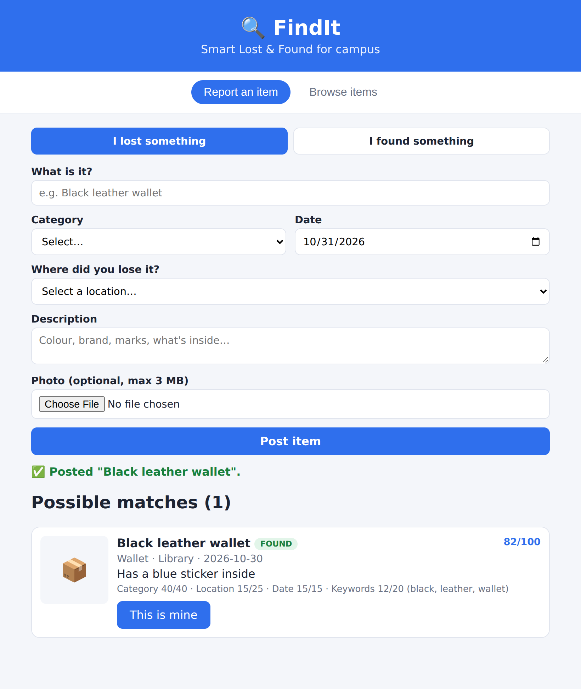
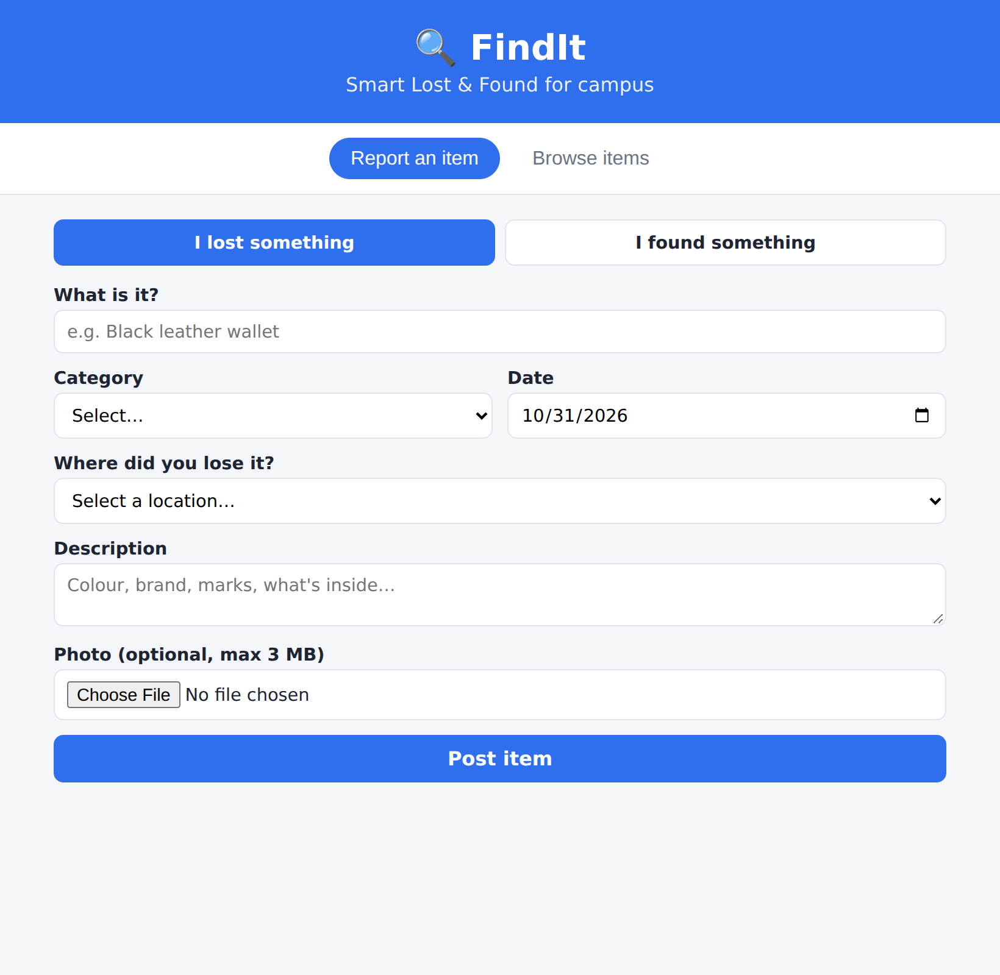
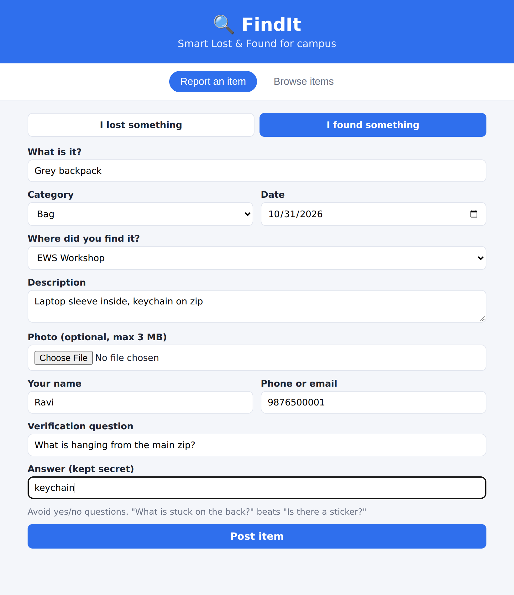
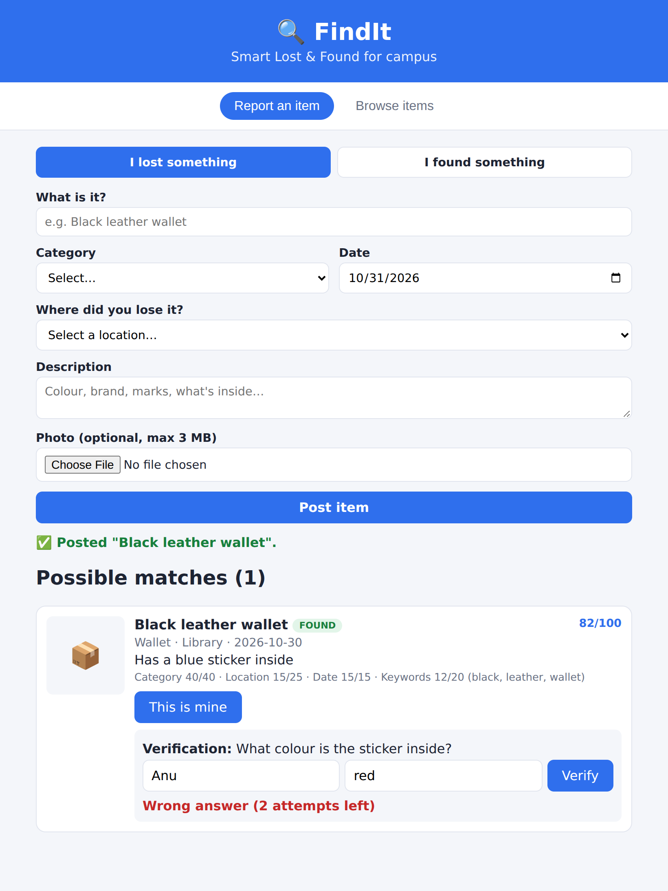
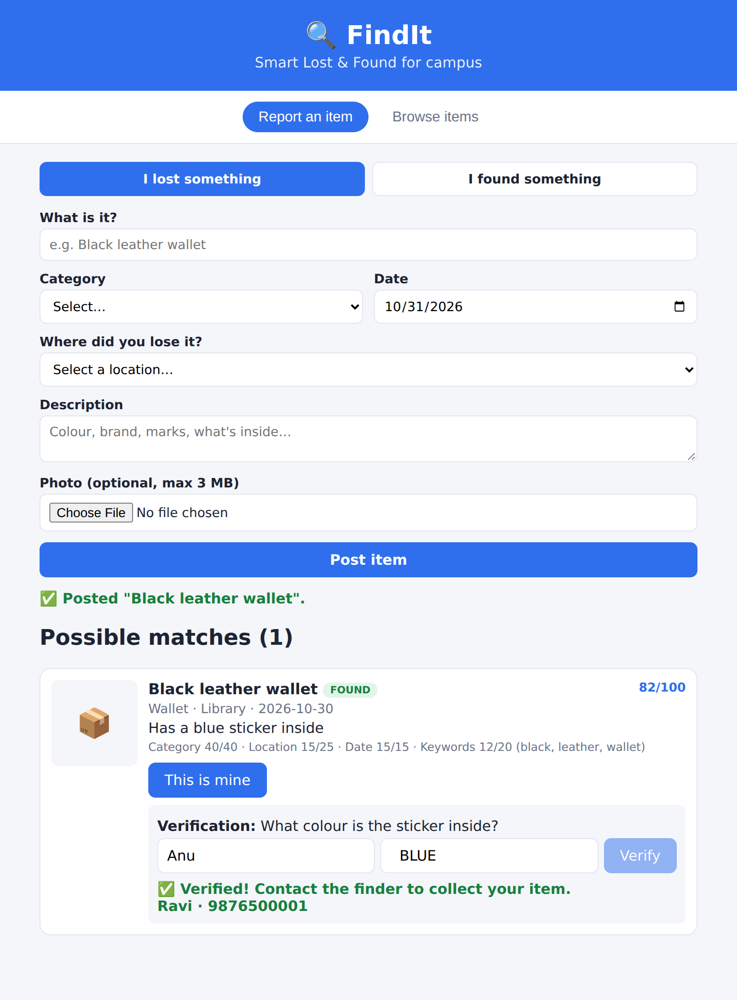
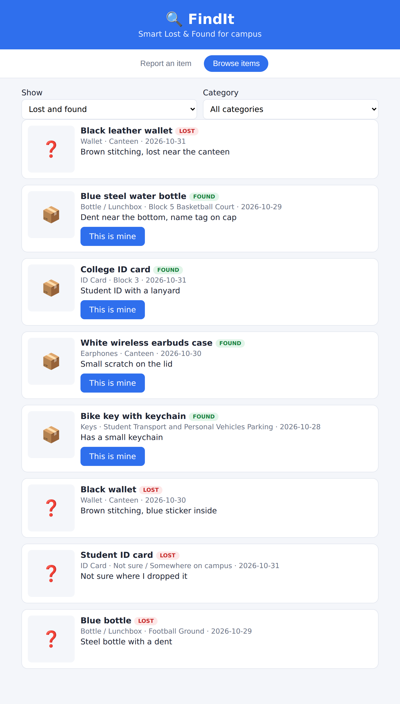
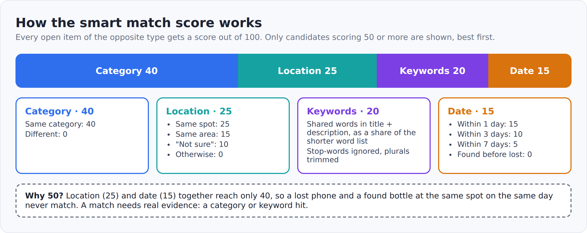
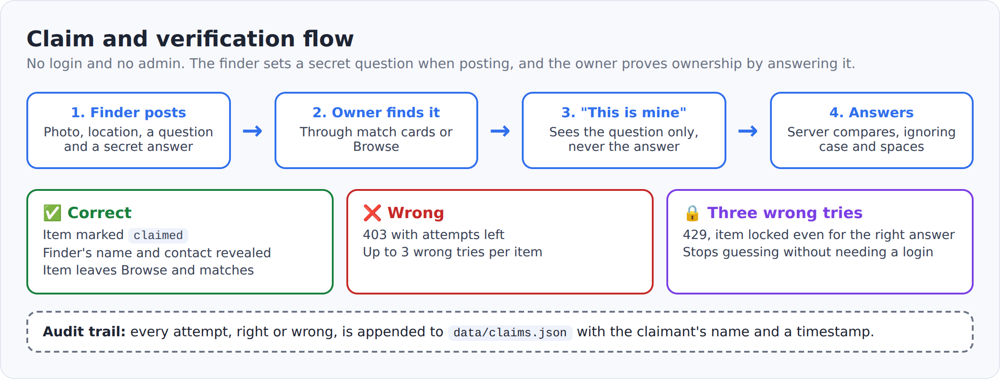
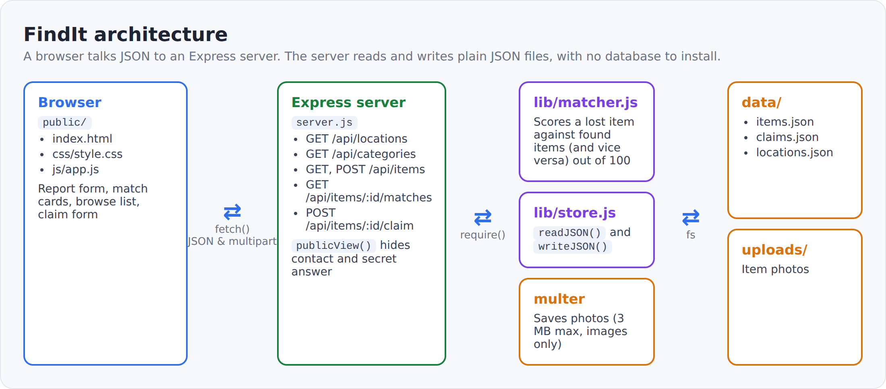

# 🔍 FindIt: Smart Lost & Found

A small campus lost-and-found system built with **Node.js and Express**. People report lost or found items, the server **automatically scores possible matches**, and owners get the finder's contact details only after **answering a secret verification question**.

No database to install, no login, no API keys. Data lives in plain JSON files, and the whole project runs with one command.

<p align="center">
  
</p>

## Features

- **Report lost or found items** with category, date, campus location and an optional photo
- **Smart matching:** every new report is scored out of 100 against open items of the opposite type, and the score breakdown is shown ("why did this match?")
- **Campus-aware locations:** 27 real campus spots grouped into areas, so "lost at the canteen, found at the library" still gets partial credit
- **Claim verification:** the finder sets a secret question, and contact details are revealed only to someone who answers it
- **Brute-force protection:** 3 wrong answers lock an item, and every attempt is logged
- **Browse and filter** open items by type and category
- **Zero setup data layer:** JSON files, with a one-command demo dataset

## Screenshots

| Report a lost item | Report a found item |
|---|---|
|  |  |

| Wrong answer (attempts left) | Verified: contact revealed |
|---|---|
|  |  |

**Browse open items**



## How the smart match score works



| Signal | Points | Rule |
|---|---|---|
| Category | 40 | Same category |
| Location | 25 / 15 / 10 | Same spot / same area / one side is "Not sure" |
| Keywords | up to 20 | Shared words in title and description, ignoring stop-words and plurals |
| Date | 15 / 10 / 5 | Within 1 / 3 / 7 days (0 if found before it was lost) |

Only candidates scoring **50 or more** are shown. Location and date alone can reach only 40, so unrelated items at the same place and time never match. The logic is in [`lib/matcher.js`](lib/matcher.js).

## How claiming works



## Architecture



## Quick start

You need **Node.js 18 or newer** ([nodejs.org](https://nodejs.org), LTS version). Check with `node -v`.

**Linux / macOS**

```bash
git clone https://github.com/saiprabhath07/findit.git
cd findit
chmod +x setup.sh run.sh
./setup.sh          # one time: checks Node, installs packages
./run.sh demo       # loads sample items and opens the browser
```

**Windows**

```bat
git clone https://github.com/saiprabhath07/findit.git
cd findit
setup.bat
run.bat demo
```

The app opens at **http://localhost:3000**.

| Command | What it does |
|---|---|
| `./run.sh` or `run.bat` | Start the app and open the browser |
| `./run.sh demo` or `run.bat demo` | Load 8 sample items, then start |
| `./run.sh reset` or `run.bat reset` | Wipe all items, claims and photos, then start |
| `npm start` | Start the server only |
| `npm run dev` | Start with auto-restart on file changes |
| `npm run demo` / `npm run reset` | Load demo data / wipe data without starting |

Use another port with `PORT=4000 ./run.sh` (Linux/macOS).

**Demo claim answers:** wallet = `blue`, bottle = `meera`, ID card = `red`, earbuds = `boat`, keys = `football`.

## Project structure

```
findit/
├── server.js            Express app and all API routes
├── lib/
│   ├── matcher.js       Match scoring
│   └── store.js         Reads and writes the JSON files
├── data/
│   ├── locations.json   Campus spots and areas (edit freely)
│   ├── items.json       Reported items (created at runtime, not in git)
│   └── claims.json      Claim attempt log (created at runtime, not in git)
├── uploads/             Item photos (not in git)
├── public/              Frontend: index.html, css/style.css, js/app.js
├── scripts/reset.js     Wipe or demo-load the data
├── setup.sh, setup.bat  One-time setup
├── run.sh, run.bat      Start scripts
└── docs/                Screenshots and diagrams used in this README
```

## API

| Method | Route | Purpose |
|---|---|---|
| GET | `/api/locations` | Campus spots with their area |
| GET | `/api/categories` | Item categories |
| GET | `/api/items?type=lost\|found` | List items (contact and secret answer are never included) |
| POST | `/api/items` | Report an item (multipart form, optional `image`) |
| GET | `/api/items/:id/matches` | Scored matches for an item |
| POST | `/api/items/:id/claim` | Answer the verification question (`claimantName`, `answer`) |

## Data and privacy

`items.json`, `claims.json` and `uploads/` hold phone numbers, names and photos, so they are listed in `.gitignore` and stay on your machine. The server never sends the finder's contact or the secret answer to the browser, except the contact after a correct claim.

## Limitations and future enhancements

- No login, so the 3-attempt lock is the only protection against guessing
- Matches are computed when an item is posted, with no email or push notifications
- JSON files suit a demo, and a real deployment would move to a database
- Image upload accepts any image type up to 3 MB, with no moderation
- Possible additions: login with roles, notifications, map-pin locations, an admin desk

## Tech stack

Node.js, Express, Multer, and plain HTML, CSS and JavaScript on the frontend.

## Team

Skill Development course project (Node.js), course code 25AI21SD1, Geethanjali College of Engineering and Technology.

- G. Angel
- P. Shanmuka Sai Prabhath
- V. Chaithanya

Guides: Prof. B. Srivani and Prof. Ch. Sushma
